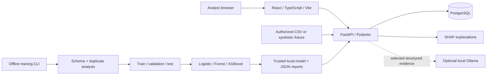

# Architecture

ARGUS is a local research modular monolith. FastAPI owns validation, database
access, inference, investigations, exports, and the optional Ollama boundary.
React consumes the same versioned HTTP API used by the automated tests.

## Boundaries and data flow

- `backend/app/ml.py`: schema, deterministic synthetic generator, training,
  metrics, manifest activation, prediction, and SHAP. Training runs offline;
  the HTTP server cannot accept or load user-supplied model files.
- `backend/app/data.py`: CSV mapping, provenance-scoped content fingerprints,
  duplicate detection, batch import scoring, separate synthetic graph seeding.
- `backend/app/db.py`: SQLAlchemy tables and session factory. PostgreSQL is the
  Compose database. SQLite is an explicit development/testing fallback.
- `backend/app/main.py`: API routes with constrained sorts, validated inputs,
  parameterized SQLAlchemy queries, investigation persistence, exports,
  CORS, upload checks, and restricted read-only Copilot context retrieval.
- `frontend/src`: analyst pages, typed API client, source badges, empty/error
  states, Recharts analytics and Cytoscape exploration. Navigation uses hash
  routes so the built SPA can be served without server route coupling.
- `scripts/bootstrap.py`: idempotent, explicit synthetic setup. It refuses
  to replace an active non-synthetic model. No data seeding on ordinary API startup.

## Persistence

Datasets own transactions. A transaction stores the feature vector, optional
observed label, content fingerprint, score, threshold, and inference model
version. Cases, case/transaction links, notes, priorities, statuses, and analyst
decisions persist in SQL. Relational graph entities and edges occupy separate
tables and have no implied ULB or scored-transaction identity.

Model directories are immutable. `current.json` is atomically replaced only after
the selected model and experiment JSON exist. Imports with different provenance
remain unscored. Activating a new model does not silently rewrite old scores;
analysts can explicitly rescore datasets. SHAP explains the active model and
reports whether its version matches the stored prediction.

## Deployment and operational limits

Compose runs PostgreSQL 17, a non-root Python API, and an Nginx-served React
build with an `/api` reverse proxy. Only loopback ports 8000 and 8080 are
published. Named volumes persist the database and model artifacts.

This MVP has **no authentication or authorization**. Keep it local or on a
trusted private research network. No bank connectivity, financial decision
execution, compliance claim, or arbitrary SQL/shell tool is provided. LLM
interpretations are not evidence and may be wrong.

Schema initialization uses SQLAlchemy `create_all`; existing-schema upgrades
require a reviewed migration before deployment. Imports/scoring are synchronous and memory-bound; dashboard metrics use SQL
aggregations to avoid hydrating the full dataset. Full ULB training was measured
in two runs, but memory profiling and throughput guarantees are not provided.
This is not a high-throughput production ingestion service. No background worker, model registry service,
calibration service, or automatic retraining is claimed.

## Analyst upgrade extension

`app/intelligence.py` adds bounded search, validated range filters, saved queries,
case timelines, entity links and graph traversal. `app/copilot.py` assembles bounded
read-only source records and validates structured citation IDs. Existing training,
model serialization and benchmark methodology are unchanged.

New `saved_views`, `case_events` and `case_entities` tables are additive. Case
creation and existing note timestamps are exposed honestly; past status changes
without recorded events are not reconstructed. Future field/link changes append
events. No event immutability against direct database administrators is claimed.

Frontend pages are separated into TransactionIntelligence, InvestigationWorkspace,
GraphIntelligence and CopilotWorkspace. Shared table/panel primitives and a
pointer/keyboard SplitPane support linked views. Global search follows record
IDs; chart selections map to the same backend filter schema used by export.
Density and splitter widths are local display preferences; saved query definitions
persist in SQL and are shared in this unauthenticated local workspace.

Live qwen2.5:7b integration was verified locally. The default remains disabled and
CI uses a mocked transport plus parser/context tests. The full PostgreSQL research
workspace is fingerprinted before/after activating the upgrade and read-only QA.
