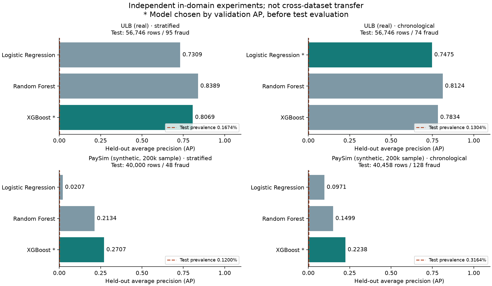

# ML methodology

Research topic: Development of a Machine Learning System for Credit Card Fraud
Detection Using Transaction Data.

## Source and validation

The intended benchmark is the [ULB / Worldline credit card fraud dataset](https://www.kaggle.com/datasets/mlg-ulb/creditcardfraud).
The official public Kaggle download was successfully retrieved on 26 October
2026 without credentials. The CSV stays in ignored `data/private/`; no mirror or
access bypass was used. This repository publishes derived evaluation reports
and source checksum metadata, not the dataset.

Features are `Time`, `V1`–`V28`, `Amount`; target `Class` is binary. Training
rejects absent/extra/duplicate columns, nonnumeric/missing/nonfinite values, negative
Time/Amount, and invalid target values. Feature-identical rows with conflicting
labels are rejected. Other feature-identical duplicates are removed before
splitting. Reports record counts, SHA-256 of the normalized dataset, partition
sizes and fraud counts, partition index digests, seed, parameters, environment,
versions, observed data types, missing-value counts, amount quantiles, time ranges,
feature meanings, and duration. Columns and numeric dtypes are canonicalized before
hashing. SHA-256 here is a reproducibility identifier, not a
privacy mechanism.

## Reproducible comparison

1. Seed 42; initial split is stratified 60% train / 20% validation / 20% test.
2. Logistic Regression uses a training-fitted StandardScaler, class-balanced
   loss, and C candidates `{0.1, 1.0}`.
3. Random Forest uses 100 trees, balanced subsample weights, minimum leaf size 2,
   and depth candidates `{6, 12}`.
4. XGBoost uses 100 histogram-boosted trees, learning rate .08, subsample and
   column subsample .9, training-only negative/positive weight, and depths `{3,5}`.
5. Each algorithm selects its parameter candidate using **validation AP**.
6. Its decision threshold maximizes F1 on the validation precision-recall curve.
   This is a research tradeoff, not a calibrated operational fraud-cost policy.
7. The winning algorithm is selected by validation AP **before** test evaluation;
   exact AP ties prefer lower measured warm single-record p95 latency. All timing
   results are retained so that the accuracy/latency trade-off is reviewable.
8. Each winning candidate receives one final evaluation on the untouched test
   partition. Reading the test results must not be used to retune the same run.
9. Serialize only the selected fitted model, preprocessing, threshold, provenance,
   background sample for SHAP, and version. Save all three evaluation reports.

No preprocessing is fitted on validation/test data. No SMOTE or preprocessing
is applied across split boundaries. Class weighting avoids synthetic resampling
and keeps the MVP practical on a 16 GB laptop. This small validation grid is
intentional; it is not an exhaustive optimization study.

Run with `--split chronological` for a separate sensitivity experiment. Equal
timestamps remain in one partition: first ~60% train, next ~20% validation, final
~20% test. All partitions must contain both classes. Two days of anonymized ULB
activity cannot establish stability across months, account groups, or merchant
segments. Stratified results assume exchangeability and can overestimate future
performance; temporal results can be unstable with few positives. Neither split
supports grouped-by-account validation because account IDs are absent.

## Metrics and interpretation

Saved metrics: precision, recall, F1, average precision (reported as PR-AUC/AP),
ROC-AUC, confusion matrix in `[[TN, FP], [FN, TP]]` order, false-positive and
false-negative rates, ROC points (up to 400), and precision-recall points sampled
at recall transitions (up to 400), preserving
both endpoints and rare positive transitions. AP uses scikit-learn's average precision,
not trapezoidal integration of the PR curve. These are distinct definitions.

With ~0.17% ULB fraud, predicting every transaction legitimate produces very
high accuracy and zero fraud recall. Accuracy is deliberately not the headline
metric. Precision changes with prevalence; synthetic fixture prevalence is 6%,
so its precision cannot be extrapolated to the ULB prevalence. Report threshold,
positive counts, and provenance alongside scores.

A `predict_proba` output is called an **uncalibrated model score**, especially
because class weighting changes the effective training distribution. No claim
of calibrated real-world fraud probability, operational savings, or causal
explanation is made. Brier score and ten quantile-bin calibration curves assess
probability quality on validation and held-out data without fitting a calibration
transformation. Class weighting and prevalence shift can make these estimates
poorly calibrated even when AP is high. The test calibration curve is descriptive;
it must not be used to refit this run.

Each model includes a validation-only threshold profile at 0.05 increments plus
its selected threshold. The profile reports precision, recall, F1, false-positive
and false-negative counts, and illustrative cost `1 × FP + 25 × FN`. These are
arbitrary, explicitly stated cost units rather than verified banking costs.
The cost illustration does not select the threshold: maximum validation F1 does.
Changing the interactive classification threshold changes decisions, not stored
model scores or held-out experiment results.

Each selected per-algorithm candidate is warmed up and timed with one sequential
caller: 20 single-record calls and five 1,000-record calls, reporting single p50/p95
and batch median/p95 in milliseconds. Inputs come from validation, repeated when
fewer than 1,000 rows are available. These are in-process `predict_proba` timings;
they exclude API validation, serialization, database access and network latency.
They must not be presented as end-to-end latency or concurrent-load guarantees.

## Explainability

SHAP LinearExplainer explains standardized logistic log-odds using training
background. TreeExplainer explains XGBoost raw margins/log-odds and forest
positive-class probability. All 30 attributions and their base value are
returned, with an exact `log-odds` or `probability` output-space label and the
score reconstructed from the attribution sum. The UI shows the largest absolute
contributions. Automated tests
check that contributions reconstruct each algorithm's output in its proper
space. Global importance is absolute standardized coefficient magnitude or
estimator tree importance, with scales that must not be compared across models.
Detailed explanations are calculated on demand. Each Predictor reuses its SHAP
explainer and retains at most 128 version-specific results in an LRU cache; model
activation clears the explanation cache on the next explanation. A separate lock
prevents SHAP work from holding the ordinary model-activation lock.

V1–V28 are anonymized components. They do not justify claims about location,
merchant, device, cardholder behavior, or an actual fraud cause. The separate
synthetic graph does not enrich or explain ULB predictions.

## Current research evidence

`docs/research/synthetic-evaluation.json` is a saved **actual run on artificial
fixtures**, not an ULB benchmark. Training uses generator seed 42 (2,000 rows).
The interactive demonstration uses independent seed 2026 (600 rows). The checked
sample upload uses seed 4401 (40 rows). These fixtures deliberately contain
learnable feature shifts and are useful for software verification only.

The ML Laboratory reads server-owned report JSON; it never synthesizes metrics.
Repeated runs retain versions; scores are reproducible with the locked dependency
versions and seed, allowing for platform floating-point differences. Timestamps
and measured durations will vary. The external benchmark extension below adds
conditional precision/recall confidence intervals. Fitted probability calibration,
multi-seed uncertainty, true transfer validation and drift monitoring remain future work.

Current-format training writes immutable version directories and atomically
activates a manifest containing a model SHA-256 checksum. Predictor verifies the
checksum before deserialization, feature order, binary class order and decision
threshold, and shares one loaded model across requests. These checks detect
accidental corruption and schema mismatches; joblib is still executable pickle
content and must come only from the trusted local training process. The checksum
is not a signature or a defense against an attacker able to replace both files.
Legacy server-owned artifacts without checksum metadata remain loadable for
backward compatibility; retrain to obtain the current artifact format.


## Actual ULB experiments (26 October 2026)

Official input: 284,807 rows; 1,081 duplicate feature rows removed; 283,726 unique
rows including 473 frauds. Both experiments use the same normalized dataset hash.
Stratified train/validation/test fraud counts are 284/94/95; chronological counts
are 342/57/74. Chronological cutoffs keep equal timestamps together.

The stratified validation selection chose XGBoost: held-out precision .9474,
recall .7579, F1 .8421, AP .8069, ROC-AUC .9793. The chronological validation
selection chose Logistic Regression: held-out precision .9423, recall .6622,
F1 .7778, AP .7475, ROC-AUC .9818. Other candidates' test results are all retained;
a higher test AP did not retroactively change selection. These experiments are
single-seed estimates without confidence intervals or deployment validation.

See `docs/research/ulb-stratified-evaluation.json`,
`docs/research/ulb-chronological-evaluation.json`, and `ulb-source.json` for exact
measurements and provenance. Training completed in 26.033 and 28.381 seconds on
this host; this is one observation, not a performance guarantee.

The interactive database may include training, validation and test rows from an
imported full CSV. Dashboard labeled-data detection rate is therefore **not** an
unseen-test metric. Only the Laboratory's saved held-out reports support the
benchmark claims above. Synthetic and ULB score versions remain separately labeled.

## Independent multi-dataset protocol (15 November 2026)

`app.benchmark_data` and `app.benchmarks` implement external offline experiments;
`app.ml` and all existing ULB models are preserved. This is **independent in-domain
training and evaluation**, not transferring a ULB-trained model to another
dataset. Features and domains differ, so neither AP comparisons nor pooled data
establish cross-dataset generalization. True transfer validation would require a
predeclared shared representation, frozen source-trained model, untouched target
labels and appropriate domain-shift analysis; none is claimed.

External adapters require labeled schemas; label-independent raw event signatures
remove duplicate events before splitting and reject conflicting labels. PaySim
retains distinct event IDs for deduplication only, whereas IEEE excludes unique
TransactionID from signatures. Signatures use pandas 64-bit hashes (not privacy
protection); report digests use SHA-256 over those fingerprints. Identity joining
is one-to-one. Neither target nor post-outcome balance/policy outputs enter PaySim
predictors. Dataset-specific field decisions and official access terms are in
[DATASETS.md](DATASETS.md).

Both external split modes reuse the tested 60/20/20 partition logic and seed 42.
Chronological boundaries keep equal timestamps/hours together, so exact partition
percentages can vary. Both classes must occur in each partition. Numeric missing
values use **training medians** (all-missing columns retained as zero), followed
by training StandardScaler. Categories use constant missing values and training
one-hot encoding capped at 32 levels per field; unknown values enter a learned
infrequent bucket if present, otherwise all zeros. No target encoding, global
imputation, oversampling or test-dependent feature selection is performed.

Each algorithm uses the same two-candidate validation grid described above
(LR C=.1/1; RF depths 6/12; XGB depths 3/5, 100 trees each). Both numeric and one-hot
features enter all three algorithms; class weights/negative-positive ratio use
training labels only. Validation AP selects parameters; exact candidate ties keep
the first declared candidate. Validation F1 selects thresholds. Validation AP
selects the algorithm; exact algorithm ties use measured warm single-record p95.
Test features are transformed and scored only after this choice. Reports retain
all candidates' validation AP and selected candidates' parameters/test metrics.
No external fitted model is activated or serialized by this report-only runner.

All required metrics, confusion matrices, PR/ROC/calibration curves, Brier score,
validation threshold profiles and timings are measured, reusing the ULB metric
implementation. External latency includes fitted feature preprocessing and
`predict_proba`, excludes CSV loading/adaptation, API/network/database/SHAP, and
uses validation inputs. These are single-host sequential timings, not cross-host
performance rankings. Legacy ULB measurements remain exactly as recorded.

### Confidence intervals and limitations

The API and external reports provide **95% Wilson binomial intervals for test
precision and recall**, conditional on the fitted model and validation-selected
threshold. Undefined precision (no positive predictions) has a null interval.
These intervals assume independent trials; recurring entities, simulator dynamics
and temporal dependence can make them too narrow. They exclude uncertainty from
training, model/threshold selection, and sampling. No F1/AP/ROC-AUC intervals or
statistical superiority/significance claim is made. Archived ULB metrics are
unchanged; Wilson intervals are derived from their saved confusion matrices at
read time, without retraining or accessing raw test predictions.

The seed-42 PaySim sample has 241 positives. Stratified train/validation/test
counts are 145/48/48; chronological counts are 96/17/128, with hours 1–280 / 281–354 /
355–741. Sparse validation positives explain threshold instability. In the
chronological XGBoost run, test precision 1.0 means18 true positives and 0 false
positives; recall is 18/128 = .1406, with Wilson 95% interval [.0908, .2114]. Its
precision interval is [.8241, 1.0]. These are weak-recall conservative baselines,
not a successful operational fraud-prevention claim. Temporal prevalence changes,
sampling and excluded balances prevent comparison with balance-based PaySim
leaderboards. Sample selection and model grids were fixed before either test
report was inspected; neither run was retuned after seeing its test results.

Published structured reports: [PaySim chronological](research/benchmarks/paysim-chronological.json),
[PaySim stratified](research/benchmarks/paysim-stratified.json), and the preserved
[diploma ULB reports](research/diploma-ulb-stratified.json). The Laboratory reads
these immutable measurements separately from active workspace artifacts. IEEE-CIS
has no measured metrics until authorized data is supplied. Unit fixtures test
IEEE preprocessing/training interfaces and do not constitute dataset evaluation.



The figure uses all twelve measured model results, not just selected test winners.
Its dashed prevalence line is a reference, not a measured random-classifier result.
Regenerate it without any training (optional plotting dependency, outside runtime):

```sh
uv run --with matplotlib==3.11.2 python scripts/plot_benchmarks.py
```
