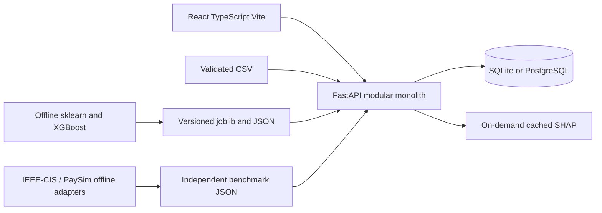

# System architecture

`backend/app/main.py` defines API contracts, request boundaries, readiness and orchestration. `data.py` imports validated CSV atomically in bounded scoring/insertion chunks. `db.py` owns SQLAlchemy entities, connection configuration and additive numbered migrations. `intelligence.py` handles advanced filters, saved views, timelines, bounded graph neighborhoods and global search. `ml.py` trains, evaluates, serializes and caches inference models and explanations.

Transactions reference datasets and retain immutable source features, observed labels, model scores, flags, applied thresholds and model versions. Cases link transactions and separate synthetic graph entities; notes and events persist analyst actions. Dataset audit metadata records observed statistics and explicitly user-declared provenance.

Frontend pages include Overview, Transaction Intelligence, Fraud Detection, Laboratory, Investigation Workbench, Graph Intelligence and System Information. Recharts shows recorded metrics; Cytoscape loads only on graph navigation. Server-side filters/pagination bound transaction responses. The graph is a separate artificial fixture with no inferred ULB entity relationships.

On startup the API applies additive migrations and attempts model loading. Health checks database reachability; readiness additionally requires a compatible model. Inference uses the cached active artifact; input validation precedes vectorized predict_proba. JSON responses retain model/version/threshold and explicitly uncalibrated estimates. SHAP is requested separately and uses the actual model with output-space/additivity metadata. API key access is optional; loopback deployment is the default.

The multi-dataset extension uses `benchmark_data.py` for explicit schema validation,
one-to-one IEEE identity joins and train-only column preprocessing, and
`benchmarks.py` for seeded offline comparisons and report catalog validation.
The Laboratory's dataset selector reads `/api/v1/benchmarks`; default workspace
experiments still use `/models`. Reports are bundled under `docs/research`,
independent of active ULB artifacts and SQL records. External evaluation writes
JSON only, never a production activation manifest. PaySim is synthetic; IEEE
access requires authorized competition data. Independently trained experiments
are not cross-dataset transfer validation. See [methodology](../ML_METHODOLOGY.md).
