# ARGUS — UI/UX before and after

The current redesign is shown first. All **39 original screenshots** remain unchanged below for comparison; the pre-redesign source is commit [`de65ba0`](https://github.com/muratkareem/argus/tree/de65ba0). No generated mockups are used.

**33 after screenshots**, captured from the running application on 14–15 November 2026 with Playwright/Chrome. Desktop viewport **1440×900**, mobile **390×844**, device scale factor 1, full-page PNGs (image height can exceed viewport height). Fonts, charts and backend responses were allowed to settle before capture. All 30 core views passed page-overflow and JavaScript-error checks; three additional methodology/navigation views were also captured. Each PNG's viewport width was validated.

The ULB workspace contains **993 existing, deduplicated transactions** from the first 1,000 original rows, scored by the existing XGBoost artifact. Its Laboratory shows the preserved full ULB experiment. Populated investigations and relationships use the existing **explicitly synthetic demonstration workspace**. No cardholder/merchant relationships are inferred from ULB. Prediction and SHAP use the real API; there are no mocked responses, new models or regenerated datasets. Existing anonymized data attribution is preserved in the original gallery below.

## Before/after links

The main workflow is Overview → Transactions → Fraud Detection → Explanation → Investigation. Evaluation and the relationship demonstration remain available under Research; administration stays in Settings. “Analytics” is part of Overview and Model performance rather than a duplicate navigation page.

| Page / feature | Before desktop | After desktop | Before mobile | After mobile |
|---|---|---|---|---|
| Dashboard / transaction activity and risk distribution | [Before](dashboard-ulb-desktop.png) | [After](after-dashboard-ulb-desktop.png) | [Before](dashboard-ulb-mobile.png) | [After](after-dashboard-ulb-mobile.png) |
| Transaction explorer / search, filters and pagination | [Before](transactions-ulb-desktop.png) | [After](after-transactions-ulb-desktop.png) | [Before](transactions-ulb-mobile.png) | [After](after-transactions-ulb-mobile.png) |
| Transaction details / observed label and model output | [Before](transaction-details-ulb-desktop.png) | [After](after-transaction-details-ulb-desktop.png) | [Before](transaction-details-ulb-mobile.png) | [After](after-transaction-details-ulb-mobile.png) |
| Stored transaction SHAP explanation | [Before](transaction-shap-ulb-desktop.png) | [After](after-transaction-shap-ulb-desktop.png) | [Before](transaction-shap-ulb-mobile.png) | [After](after-transaction-shap-ulb-mobile.png) |
| Progressive transaction input / exact 30-feature schema | [Before](fraud-prediction-form-ulb-desktop.png) | [After](after-fraud-prediction-form-ulb-desktop.png) | [Before](fraud-prediction-form-ulb-mobile.png) | [After](after-fraud-prediction-form-ulb-mobile.png) |
| Fraud prediction / probability estimate and risk classification | [Before](fraud-prediction-result-ulb-desktop.png) | [After](after-fraud-prediction-result-ulb-desktop.png) | [Before](fraud-prediction-result-ulb-mobile.png) | [After](after-fraud-prediction-result-ulb-mobile.png) |
| Direct prediction / positive and negative SHAP contributions | [Before](fraud-prediction-shap-ulb-desktop.png) | [After](after-fraud-prediction-shap-ulb-desktop.png) | [Before](fraud-prediction-shap-ulb-mobile.png) | [After](after-fraud-prediction-shap-ulb-mobile.png) |
| Model performance / comparison and test results | [Before](model-performance-ulb-desktop.png) | [After](after-model-performance-ulb-desktop.png) | [Before](model-performance-ulb-mobile.png) | [After](after-model-performance-ulb-mobile.png) |
| Analytics / validation threshold and illustrative cost trade-offs | [Before](analytics-thresholds-ulb-desktop.png) | [After](after-analytics-thresholds-ulb-desktop.png) | [Before](analytics-thresholds-ulb-mobile.png) | [After](after-analytics-thresholds-ulb-mobile.png) |
| Investigation queue / real-data empty state | [Before](investigations-ulb-empty-desktop.png) | [After](after-investigations-ulb-empty-desktop.png) | [Before](investigations-ulb-empty-mobile.png) | [After](after-investigations-ulb-empty-mobile.png) |
| System information / model, dataset, health and schema | [Before](system-information-ulb-desktop.png) | [After](after-system-information-ulb-desktop.png) | [Before](system-information-ulb-mobile.png) | [After](after-system-information-ulb-mobile.png) |
| Dataset import / schema and provenance controls | [Before](dataset-import-dialog-desktop.png) | [After](after-dataset-import-dialog-desktop.png) | [Before](dataset-import-dialog-mobile.png) | [After](after-dataset-import-dialog-mobile.png) |
| Workspace search / keyboard navigation | [Before](workspace-search-desktop.png) | [After](after-workspace-search-desktop.png) | [Before](workspace-search-mobile.png) | [After](after-workspace-search-mobile.png) |
| Investigation workbench / existing saved case, evidence and timeline | [Before](investigation-workbench-synthetic-desktop.png) | [After](after-investigation-workbench-synthetic-desktop.png) | [Before](investigation-workbench-synthetic-mobile.png) | [After](after-investigation-workbench-synthetic-mobile.png) |
| Intelligence graph / entity inspection and relationships | [Before](intelligence-graph-synthetic-desktop.png) | [After](after-intelligence-graph-synthetic-desktop.png) | [Before](intelligence-graph-synthetic-mobile.png) | [After](after-intelligence-graph-synthetic-mobile.png) |
| Model performance / feature importance and experiment integrity | [Before](model-performance-ulb-desktop.png) | [After](after-model-methodology-ulb-desktop.png) | [Before](model-performance-ulb-mobile.png) | [After](after-model-methodology-ulb-mobile.png) |
| Mobile navigation | — | — | [Icon rail](dashboard-ulb-mobile.png) | [Labeled menu](after-mobile-navigation.png) |

## Current previews

Dashboard / transaction activity and risk distribution

Source: 993 stored ULB records; existing XGBoost model.

[after-dashboard-ulb-desktop.png](after-dashboard-ulb-desktop.png) · viewport 1440×900 · full-page image 1440×1313

<a href="after-dashboard-ulb-desktop.png">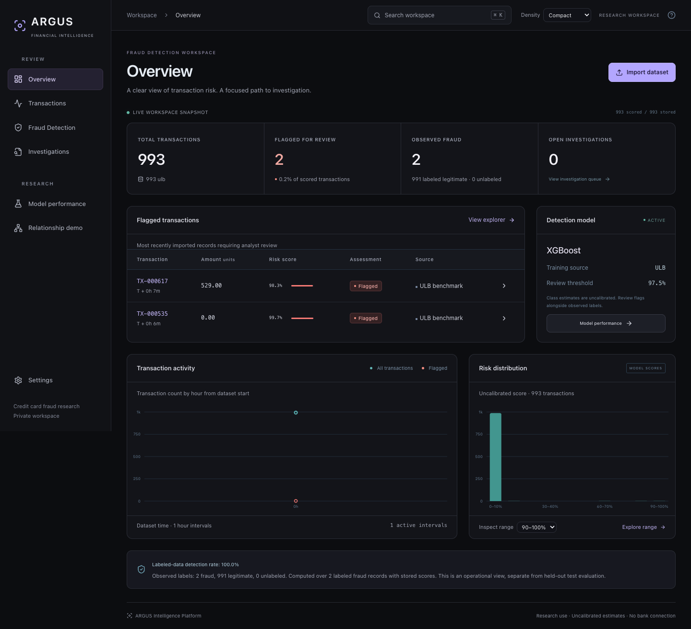</a>

[after-dashboard-ulb-mobile.png](after-dashboard-ulb-mobile.png) · viewport 390×844 · full-page image 390×2205

<a href="after-dashboard-ulb-mobile.png">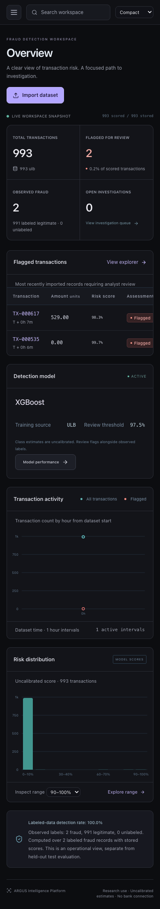</a>

Transaction explorer / search, filters and pagination

Source: ULB.

[after-transactions-ulb-desktop.png](after-transactions-ulb-desktop.png) · viewport 1440×900 · full-page image 1440×2091

<a href="after-transactions-ulb-desktop.png">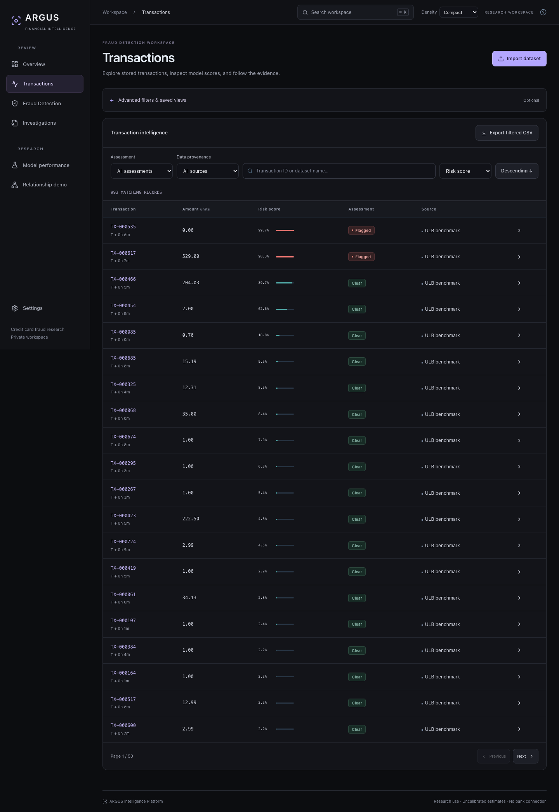</a>

[after-transactions-ulb-mobile.png](after-transactions-ulb-mobile.png) · viewport 390×844 · full-page image 390×2183

<a href="after-transactions-ulb-mobile.png">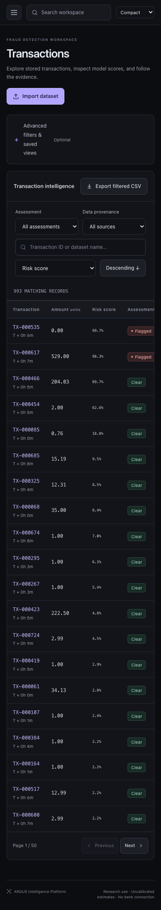</a>

Transaction details / observed label and model output

Source: ULB.

[after-transaction-details-ulb-desktop.png](after-transaction-details-ulb-desktop.png) · viewport 1440×900 · full-page image 1440×2091

<a href="after-transaction-details-ulb-desktop.png">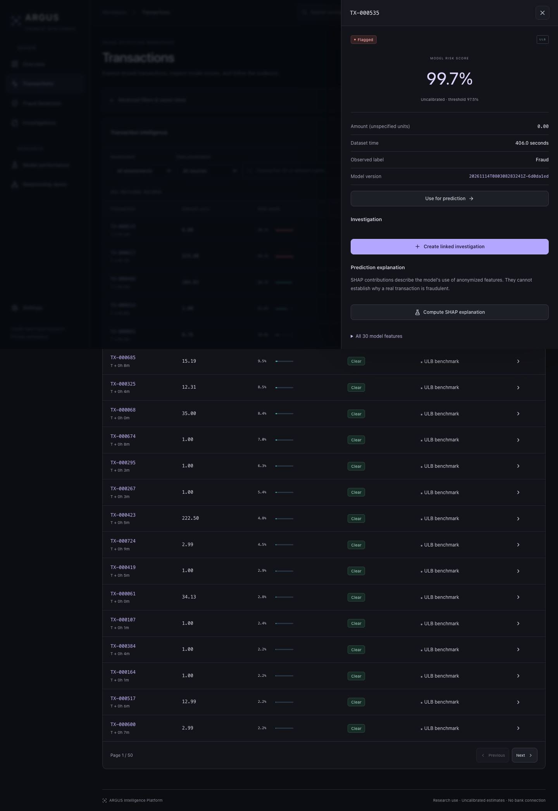</a>

[after-transaction-details-ulb-mobile.png](after-transaction-details-ulb-mobile.png) · viewport 390×844 · full-page image 390×2183

<a href="after-transaction-details-ulb-mobile.png">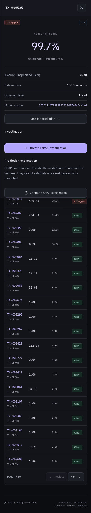</a>

Stored transaction SHAP explanation

Source: ULB; actual active XGBoost contributions.

[after-transaction-shap-ulb-desktop.png](after-transaction-shap-ulb-desktop.png) · viewport 1440×900 · full-page image 1440×2091

<a href="after-transaction-shap-ulb-desktop.png">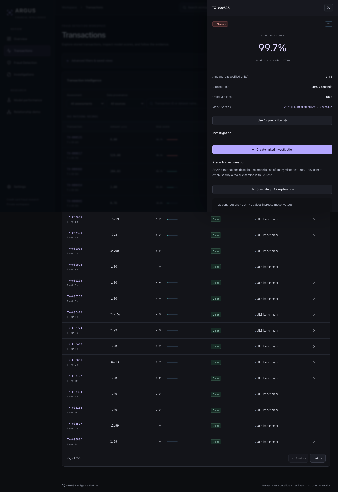</a>

[after-transaction-shap-ulb-mobile.png](after-transaction-shap-ulb-mobile.png) · viewport 390×844 · full-page image 390×2183

<a href="after-transaction-shap-ulb-mobile.png">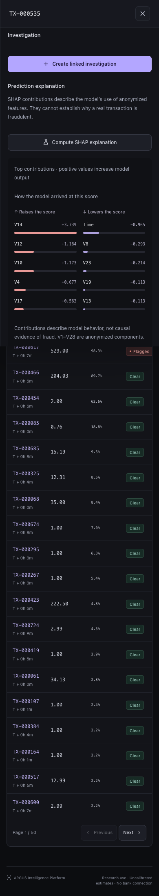</a>

Progressive transaction input / exact 30-feature schema

Source: Stored ULB example; no fabricated feature values.

[after-fraud-prediction-form-ulb-desktop.png](after-fraud-prediction-form-ulb-desktop.png) · viewport 1440×900 · full-page image 1440×1258

<a href="after-fraud-prediction-form-ulb-desktop.png">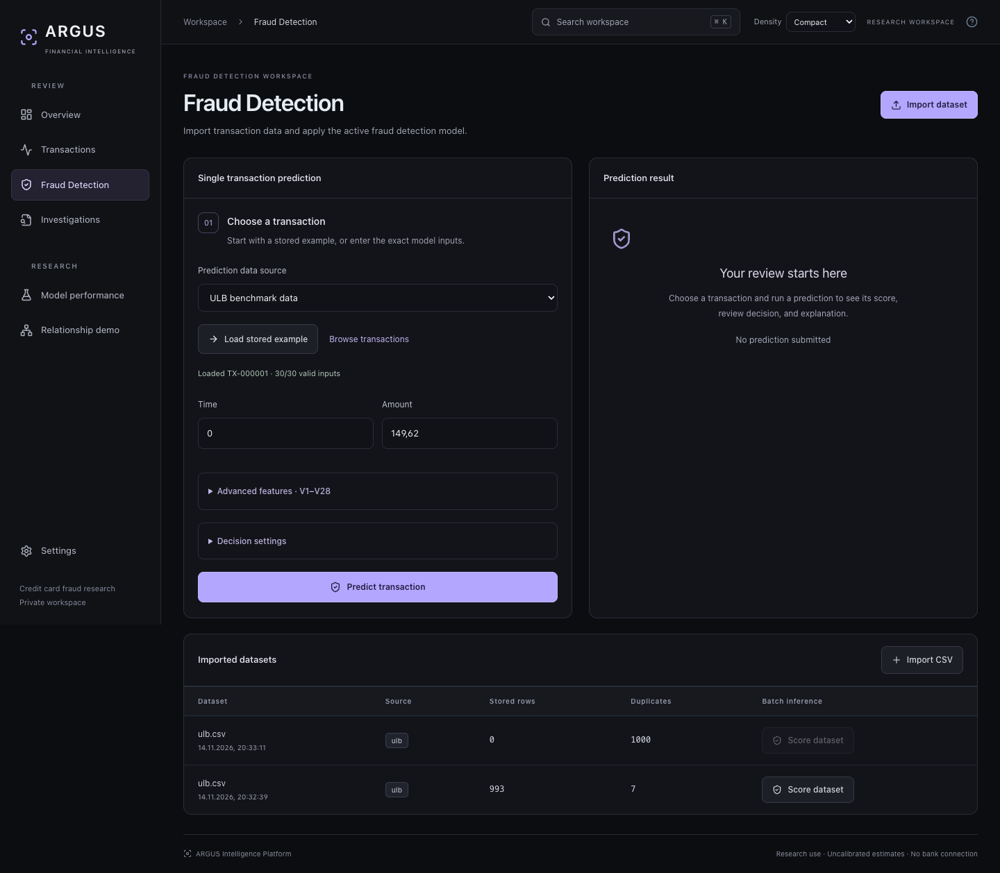</a>

[after-fraud-prediction-form-ulb-mobile.png](after-fraud-prediction-form-ulb-mobile.png) · viewport 390×844 · full-page image 390×1632

<a href="after-fraud-prediction-form-ulb-mobile.png">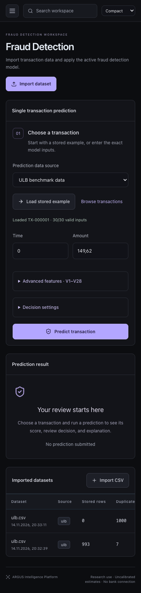</a>

Fraud prediction / probability estimate and risk classification

Source: ULB; actual inference, uncalibrated estimate.

[after-fraud-prediction-result-ulb-desktop.png](after-fraud-prediction-result-ulb-desktop.png) · viewport 1440×900 · full-page image 1440×1258

<a href="after-fraud-prediction-result-ulb-desktop.png">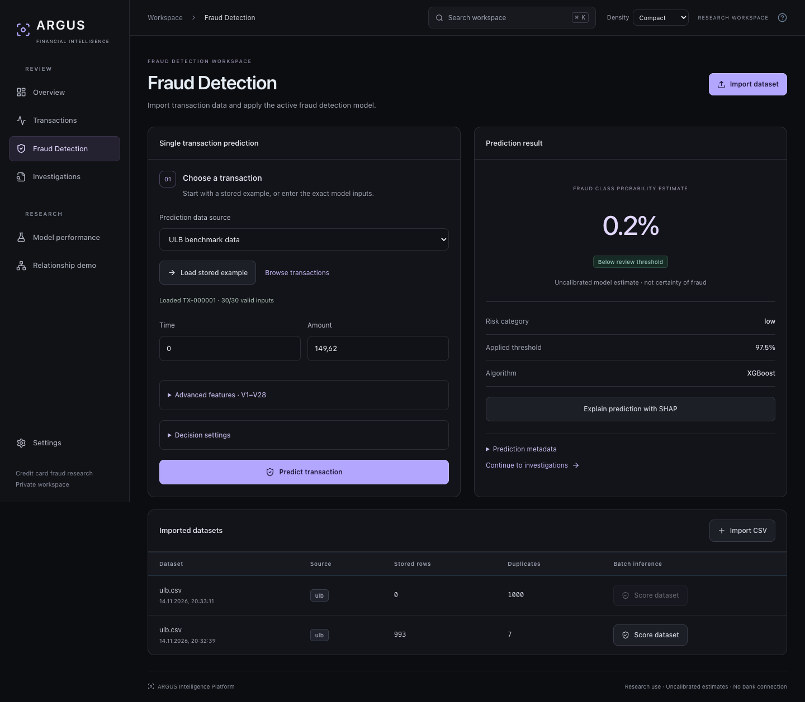</a>

[after-fraud-prediction-result-ulb-mobile.png](after-fraud-prediction-result-ulb-mobile.png) · viewport 390×844 · full-page image 390×1974

<a href="after-fraud-prediction-result-ulb-mobile.png">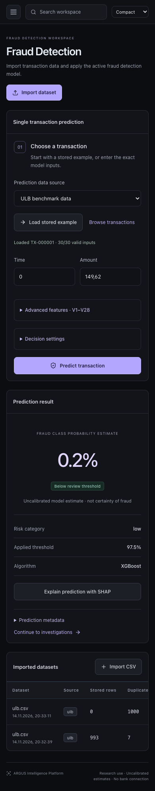</a>

Direct prediction / positive and negative SHAP contributions

Source: ULB; computed on demand.

[after-fraud-prediction-shap-ulb-desktop.png](after-fraud-prediction-shap-ulb-desktop.png) · viewport 1440×900 · full-page image 1440×1703

<a href="after-fraud-prediction-shap-ulb-desktop.png">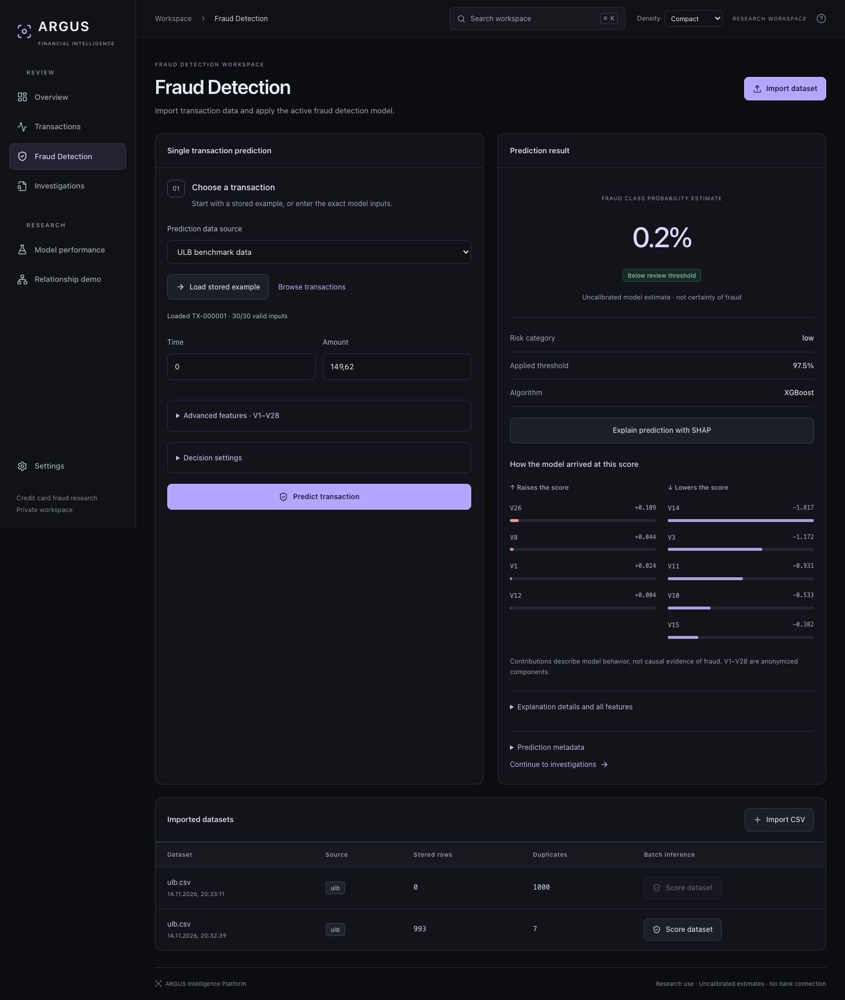</a>

[after-fraud-prediction-shap-ulb-mobile.png](after-fraud-prediction-shap-ulb-mobile.png) · viewport 390×844 · full-page image 390×2443

<a href="after-fraud-prediction-shap-ulb-mobile.png">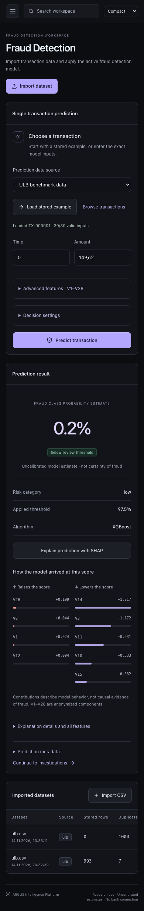</a>

Model performance / comparison and test results

Source: Preserved full ULB stratified experiment; not the 993-row demo evaluation.

[after-model-performance-ulb-desktop.png](after-model-performance-ulb-desktop.png) · viewport 1440×900 · full-page image 1440×1209

<a href="after-model-performance-ulb-desktop.png">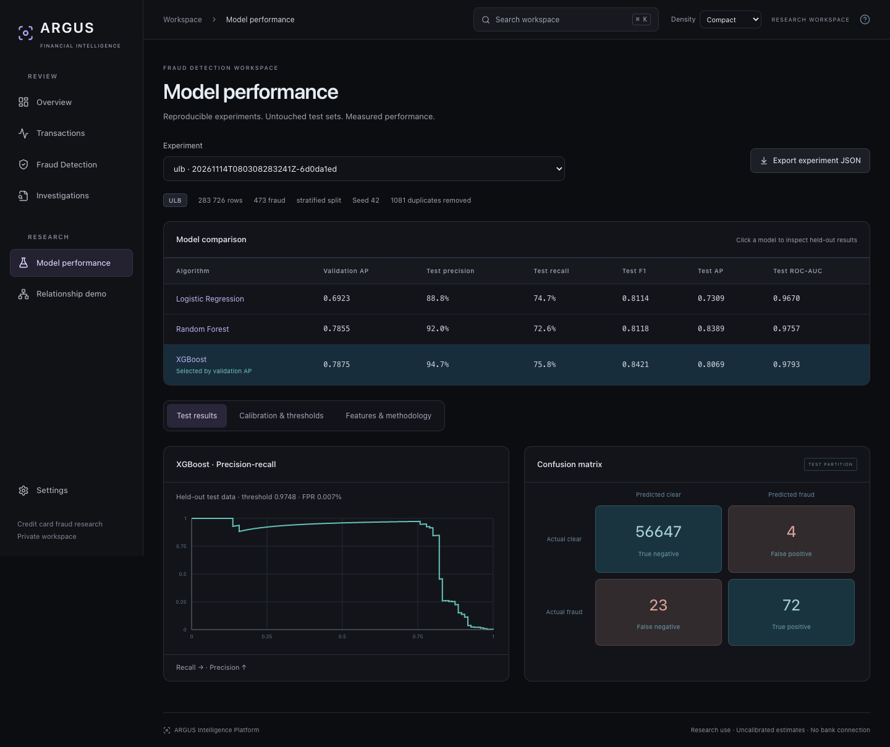</a>

[after-model-performance-ulb-mobile.png](after-model-performance-ulb-mobile.png) · viewport 390×844 · full-page image 390×1645

<a href="after-model-performance-ulb-mobile.png">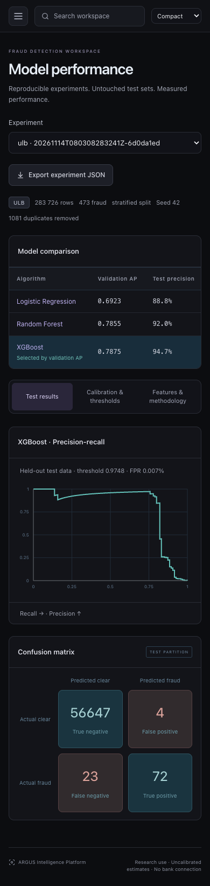</a>

Analytics / validation threshold and illustrative cost trade-offs

Source: Existing validation results; display selection only.

[after-analytics-thresholds-ulb-desktop.png](after-analytics-thresholds-ulb-desktop.png) · viewport 1440×900 · full-page image 1440×1647

<a href="after-analytics-thresholds-ulb-desktop.png">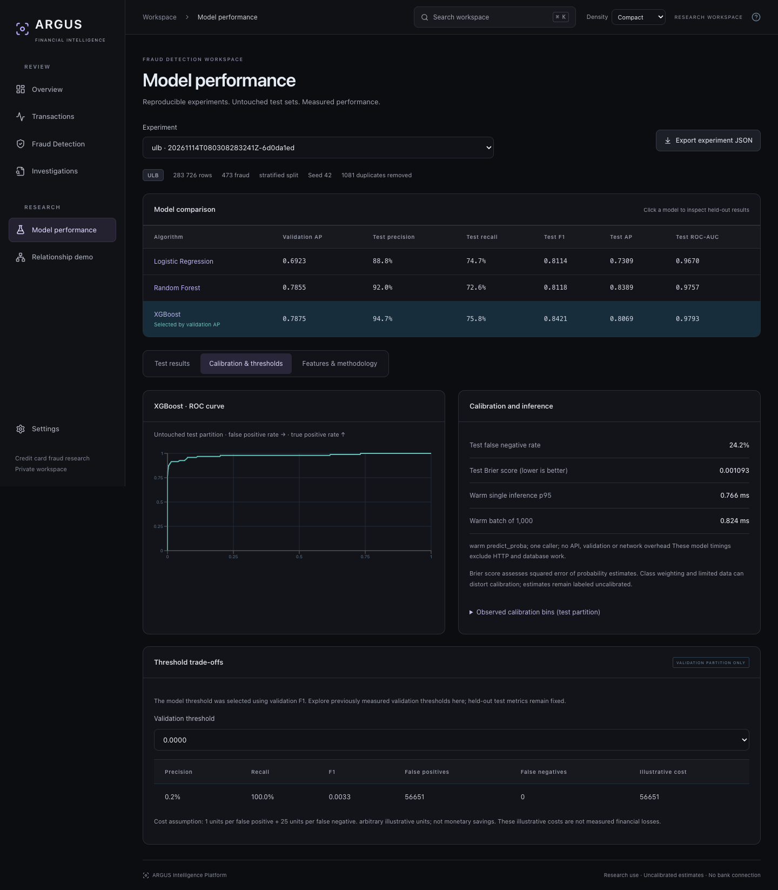</a>

[after-analytics-thresholds-ulb-mobile.png](after-analytics-thresholds-ulb-mobile.png) · viewport 390×844 · full-page image 390×2218

<a href="after-analytics-thresholds-ulb-mobile.png">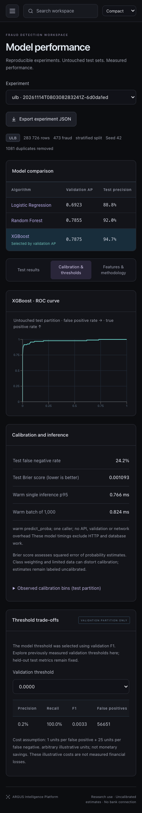</a>

Investigation queue / real-data empty state

Source: Existing ULB workspace has no saved cases; populated saved cases are captured separately.

[after-investigations-ulb-empty-desktop.png](after-investigations-ulb-empty-desktop.png) · viewport 1440×900 · full-page image 1440×961

<a href="after-investigations-ulb-empty-desktop.png">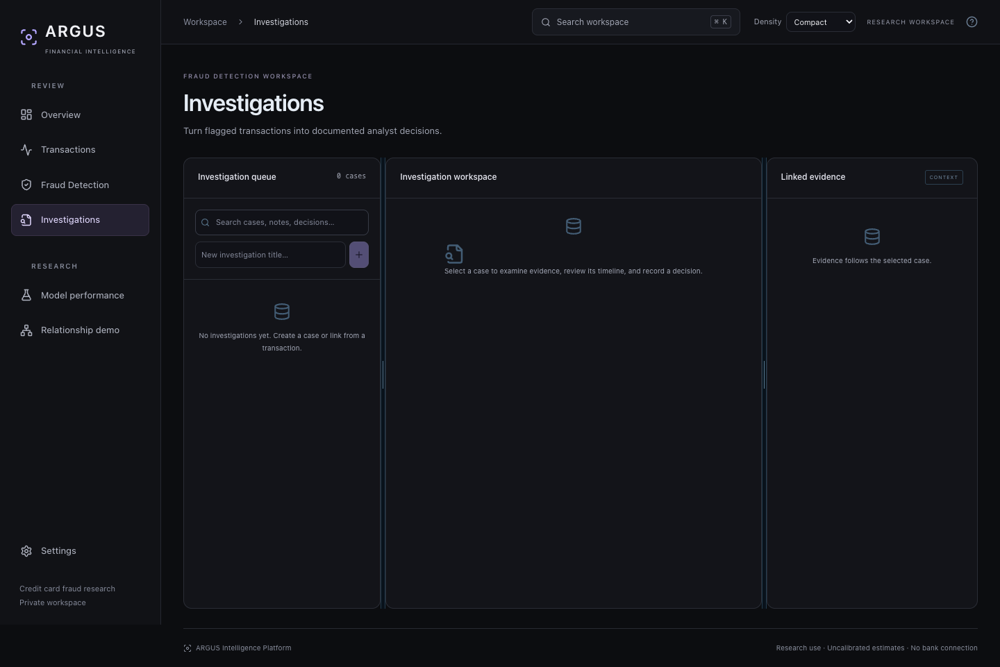</a>

[after-investigations-ulb-empty-mobile.png](after-investigations-ulb-empty-mobile.png) · viewport 390×844 · full-page image 390×1045

<a href="after-investigations-ulb-empty-mobile.png">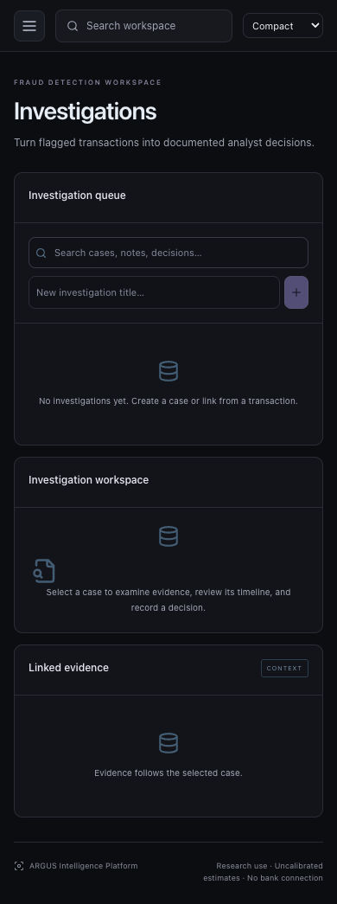</a>

System information / model, dataset, health and schema

Source: Actual runtime metadata; access-key input is empty.

[after-system-information-ulb-desktop.png](after-system-information-ulb-desktop.png) · viewport 1440×900 · full-page image 1440×1353

<a href="after-system-information-ulb-desktop.png">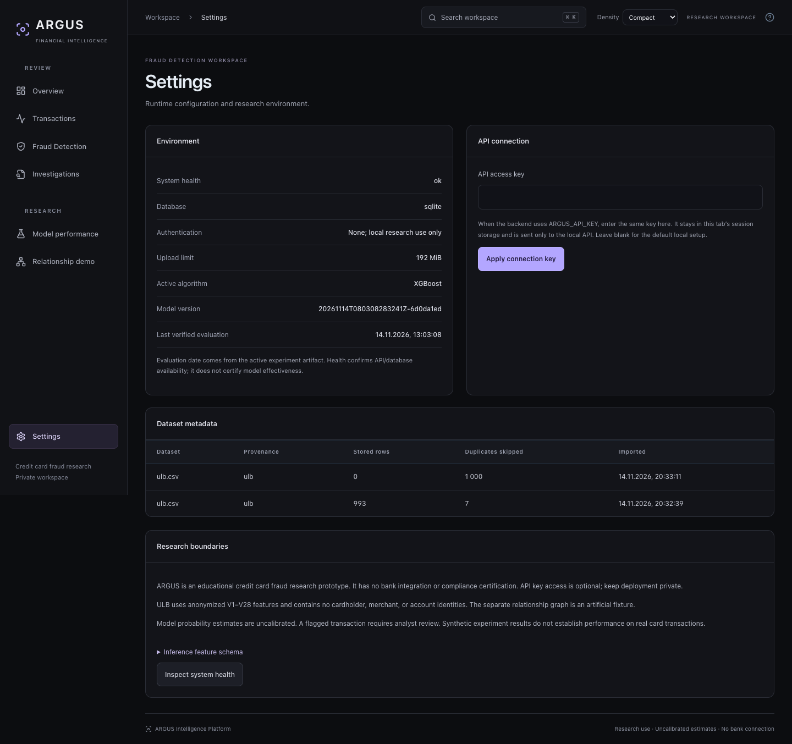</a>

[after-system-information-ulb-mobile.png](after-system-information-ulb-mobile.png) · viewport 390×844 · full-page image 390×1827

<a href="after-system-information-ulb-mobile.png">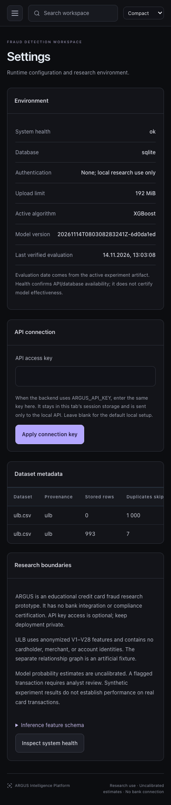</a>

Dataset import / schema and provenance controls

Source: Existing import UI; no file selected or uploaded.

[after-dataset-import-dialog-desktop.png](after-dataset-import-dialog-desktop.png) · viewport 1440×900 · full-page image 1440×1313

<a href="after-dataset-import-dialog-desktop.png">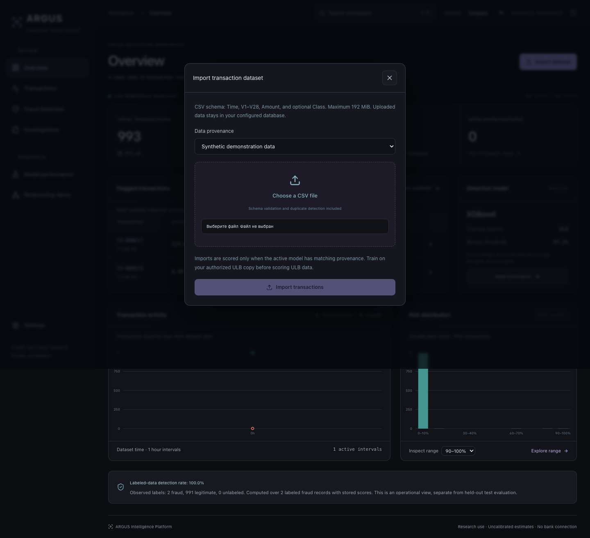</a>

[after-dataset-import-dialog-mobile.png](after-dataset-import-dialog-mobile.png) · viewport 390×844 · full-page image 390×2205

<a href="after-dataset-import-dialog-mobile.png">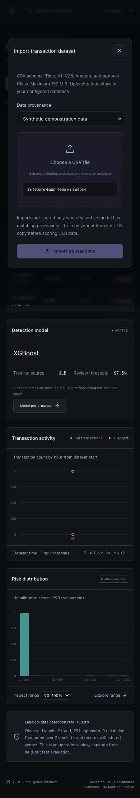</a>

Workspace search / keyboard navigation

Source: Existing command menu; no writes.

[after-workspace-search-desktop.png](after-workspace-search-desktop.png) · viewport 1440×900 · full-page image 1440×1313

<a href="after-workspace-search-desktop.png">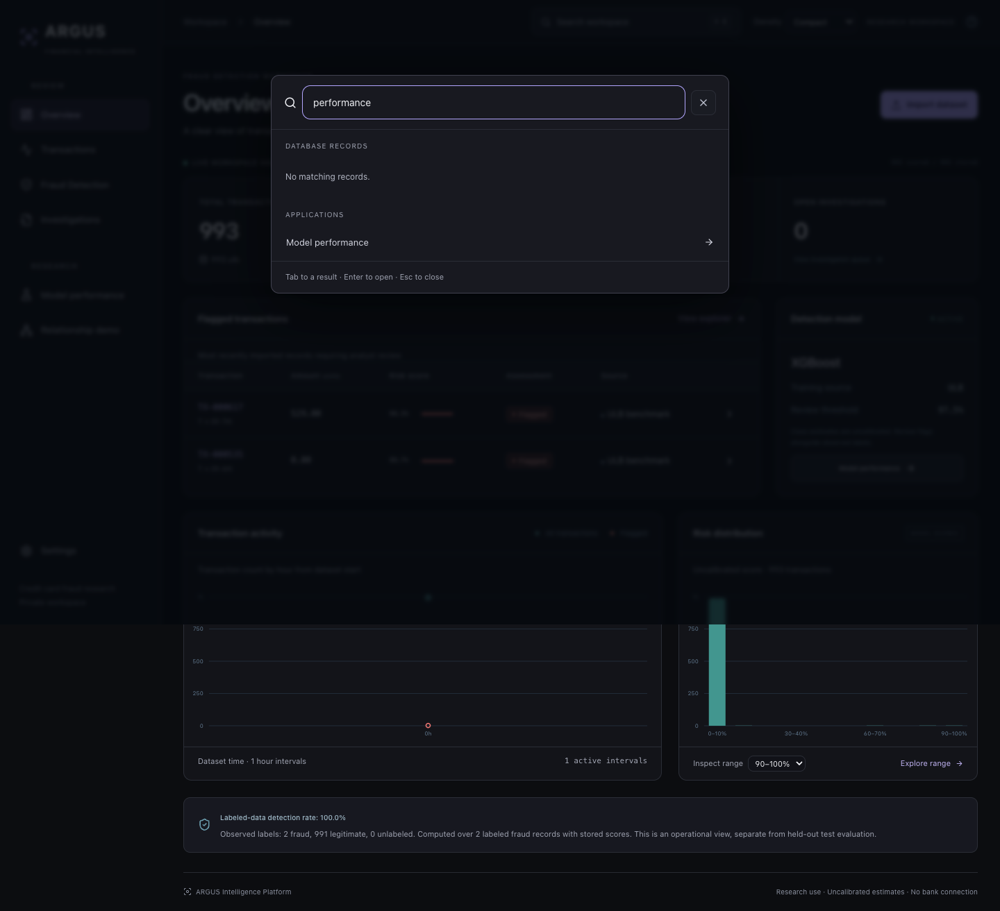</a>

[after-workspace-search-mobile.png](after-workspace-search-mobile.png) · viewport 390×844 · full-page image 390×2205

<a href="after-workspace-search-mobile.png">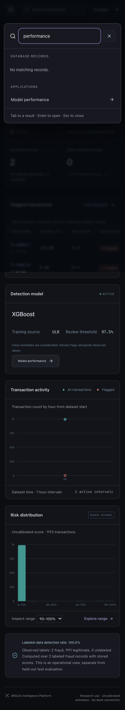</a>

Investigation workbench / existing saved case, evidence and timeline

Source: Existing persisted synthetic demonstration case; no new notes/cases created.

[after-investigation-workbench-synthetic-desktop.png](after-investigation-workbench-synthetic-desktop.png) · viewport 1440×900 · full-page image 1440×1137

<a href="after-investigation-workbench-synthetic-desktop.png">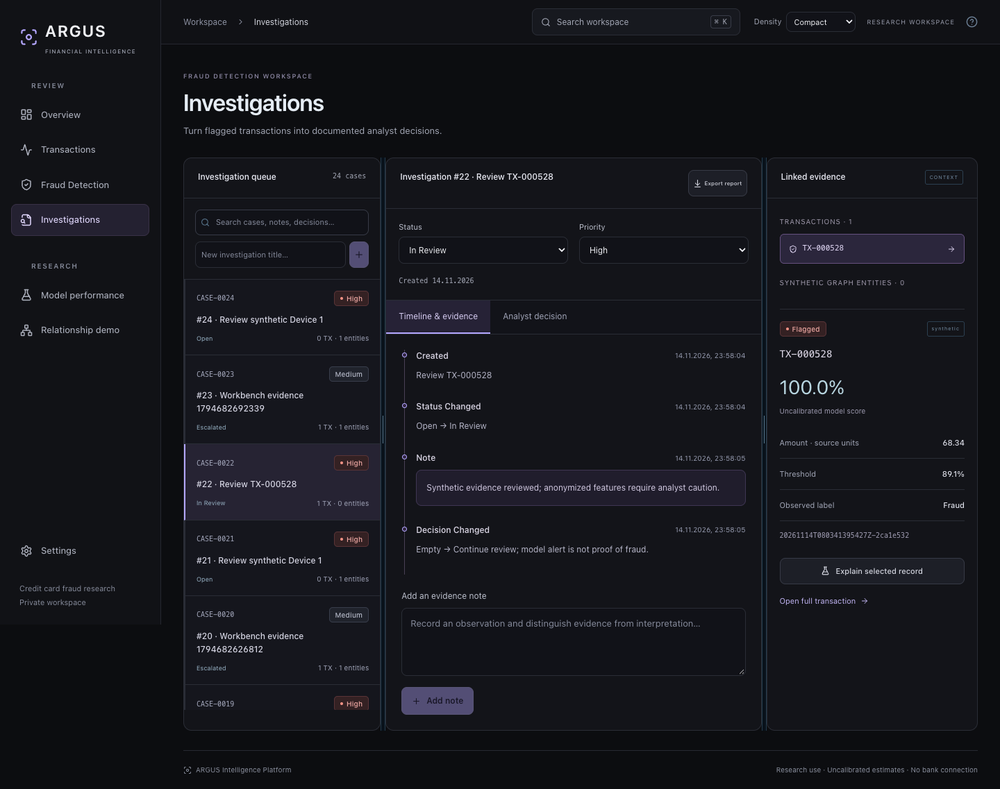</a>

[after-investigation-workbench-synthetic-mobile.png](after-investigation-workbench-synthetic-mobile.png) · viewport 390×844 · full-page image 390×2292

<a href="after-investigation-workbench-synthetic-mobile.png">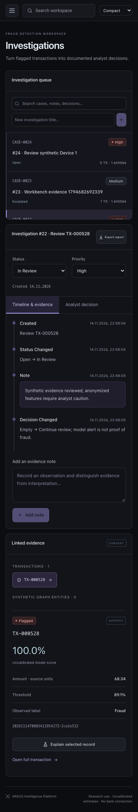</a>

Intelligence graph / entity inspection and relationships

Source: Existing separate synthetic relational fixture; no ULB identities or inferred relationships.

[after-intelligence-graph-synthetic-desktop.png](after-intelligence-graph-synthetic-desktop.png) · viewport 1440×900 · full-page image 1440×1543

<a href="after-intelligence-graph-synthetic-desktop.png">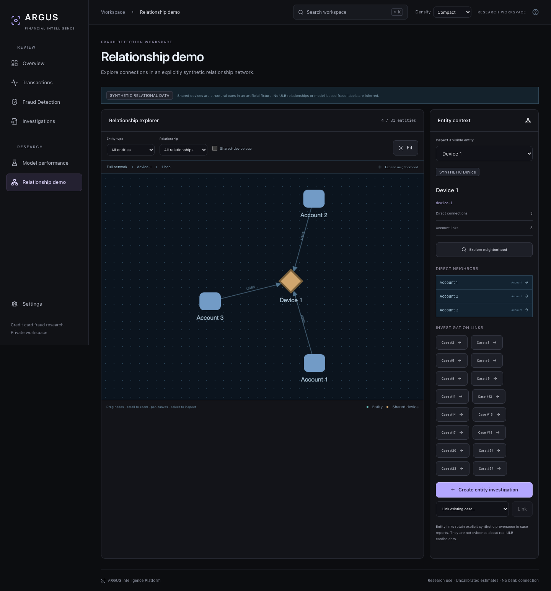</a>

[after-intelligence-graph-synthetic-mobile.png](after-intelligence-graph-synthetic-mobile.png) · viewport 390×844 · full-page image 390×2191

<a href="after-intelligence-graph-synthetic-mobile.png">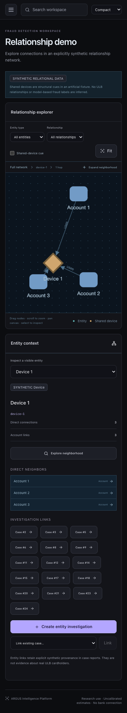</a>

Model performance / feature importance and experiment integrity

Source: Existing complete ULB experiment.

[after-model-methodology-ulb-desktop.png](after-model-methodology-ulb-desktop.png) · viewport 1440×900 · full-page image 1440×1374

<a href="after-model-methodology-ulb-desktop.png">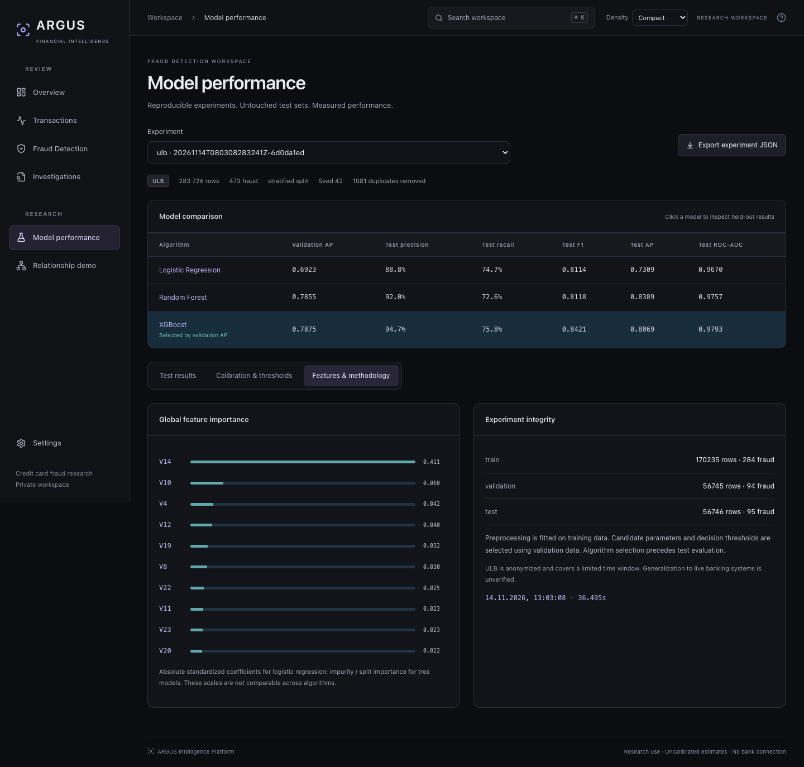</a>

[after-model-methodology-ulb-mobile.png](after-model-methodology-ulb-mobile.png) · viewport 390×844 · full-page image 390×1911

<a href="after-model-methodology-ulb-mobile.png">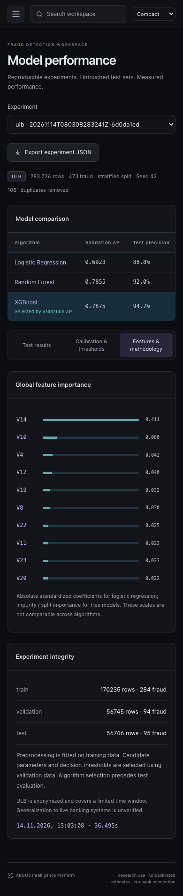</a>

Mobile navigation / labeled workflow and research tools

Source: Existing ULB workspace.

[after-mobile-navigation.png](after-mobile-navigation.png) · viewport 390×844 · full-page image 390×844

<a href="after-mobile-navigation.png">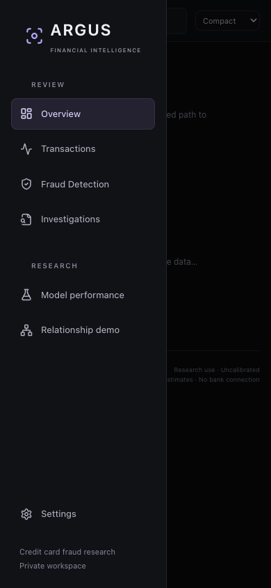</a>

---

# Before redesign — original screenshot gallery

Captured on 14 November 2026 using Playwright with headless Google Chrome against the existing, running ARGUS application. These are browser screenshots, not mockups or generated images. No UI, feature, or application-logic changes were made.

- **Desktop:** 1440 × 900 viewport, device scale factor 1, full-page PNG.
- **Mobile:** 390 × 844 viewport, device scale factor 1, full-page PNG.
- Full-page image heights extend beyond the viewport. Transaction drawers and dialogs retain the application's native scrolling and viewport bounds; the direct-prediction SHAP images show the full result panel.
- **ULB views:** 993 already stored unique transactions from the first 1,000 source rows, scored with the existing XGBoost artifact `20261114T080308283241Z-6d0da1ed`. Laboratory charts use the preserved full stratified experiment, not a fresh evaluation on this displayed subset.
- **Investigation and graph:** existing saved cases and the separate synthetic relational fixture from the persisted demonstration workspace. These screenshots are explicitly labeled synthetic; no ULB identities or relationships are invented. The ULB investigation empty state is also included.
- Predictions/explanations were requested through the real API. No network responses were mocked, no records/cases/notes were created, no models were trained, and no CSV was uploaded during capture. The import dialog is shown without a selected file, and the system access-key field is empty.
- **Analytics coverage:** ARGUS has no standalone Analytics route. Dashboard activity/risk charts and Laboratory ROC, PR, calibration, confusion-matrix, feature-importance and validation-threshold/cost analysis are captured on their existing pages.

ULB attribution: Contains information from the Worldline/Université Libre de Bruxelles Machine Learning Group [Credit Card Fraud Detection database](https://www.kaggle.com/datasets/mlg-ulb/creditcardfraud), under [ODbL v1.0](https://opendatacommons.org/licenses/odbl/1-0/) with [DbCL v1.0](https://opendatacommons.org/licenses/dbcl/1-0/) contents. See [dataset license review](../DATASET_LICENSE.md). Estimates are uncalibrated; a flag is not a factual fraud determination.

## Original captures — 30 images

Each link opens the full-resolution PNG. Expand the sections below for previews.

| Page or feature | Desktop | Mobile |
|---|---|---|
| Dashboard / transaction activity and risk distribution | [1440×1439](dashboard-ulb-desktop.png) | [390×2113](dashboard-ulb-mobile.png) |
| Transaction explorer / search, filters and pagination | [1440×1512](transactions-ulb-desktop.png) | [390×2249](transactions-ulb-mobile.png) |
| Transaction details / observed label and model output | [1440×1512](transaction-details-ulb-desktop.png) | [390×2249](transaction-details-ulb-mobile.png) |
| Stored transaction SHAP explanation | [1440×1512](transaction-shap-ulb-desktop.png) | [390×2249](transaction-shap-ulb-mobile.png) |
| Fraud prediction / actual 30-feature input | [1440×1634](fraud-prediction-form-ulb-desktop.png) | [390×2767](fraud-prediction-form-ulb-mobile.png) |
| Fraud prediction / probability estimate and risk classification | [1440×1634](fraud-prediction-result-ulb-desktop.png) | [390×3150](fraud-prediction-result-ulb-mobile.png) |
| Direct prediction / positive and negative SHAP contributions | [1440×2090](fraud-prediction-shap-ulb-desktop.png) | [390×3894](fraud-prediction-shap-ulb-mobile.png) |
| Model performance / comparison, confusion matrix, PR/ROC and calibration | [1440×2194](model-performance-ulb-desktop.png) | [390×3535](model-performance-ulb-mobile.png) |
| Analytics / validation threshold and illustrative cost trade-offs | [1440×2194](analytics-thresholds-ulb-desktop.png) | [390×3535](analytics-thresholds-ulb-mobile.png) |
| Investigation queue / real-data empty state | [1440×966](investigations-ulb-empty-desktop.png) | [390×1218](investigations-ulb-empty-mobile.png) |
| System information / model, dataset, health and schema | [1440×1153](system-information-ulb-desktop.png) | [390×1687](system-information-ulb-mobile.png) |
| Dataset import / schema and provenance controls | [1440×1439](dataset-import-dialog-desktop.png) | [390×2113](dataset-import-dialog-mobile.png) |
| Workspace search / keyboard navigation | [1440×1439](workspace-search-desktop.png) | [390×2113](workspace-search-mobile.png) |
| Investigation workbench / existing saved case, evidence and timeline | [1440×1142](investigation-workbench-synthetic-desktop.png) | [390×2337](investigation-workbench-synthetic-mobile.png) |
| Intelligence graph / entity inspection and relationships | [1440×1174](intelligence-graph-synthetic-desktop.png) | [390×1911](intelligence-graph-synthetic-mobile.png) |

## Original previews

Dashboard / transaction activity and risk distribution

Source: 993 stored ULB records; existing XGBoost model.

**Desktop** · viewport 1440×900; PNG 1440×1439 · [dashboard-ulb-desktop.png](dashboard-ulb-desktop.png)

<a href="dashboard-ulb-desktop.png">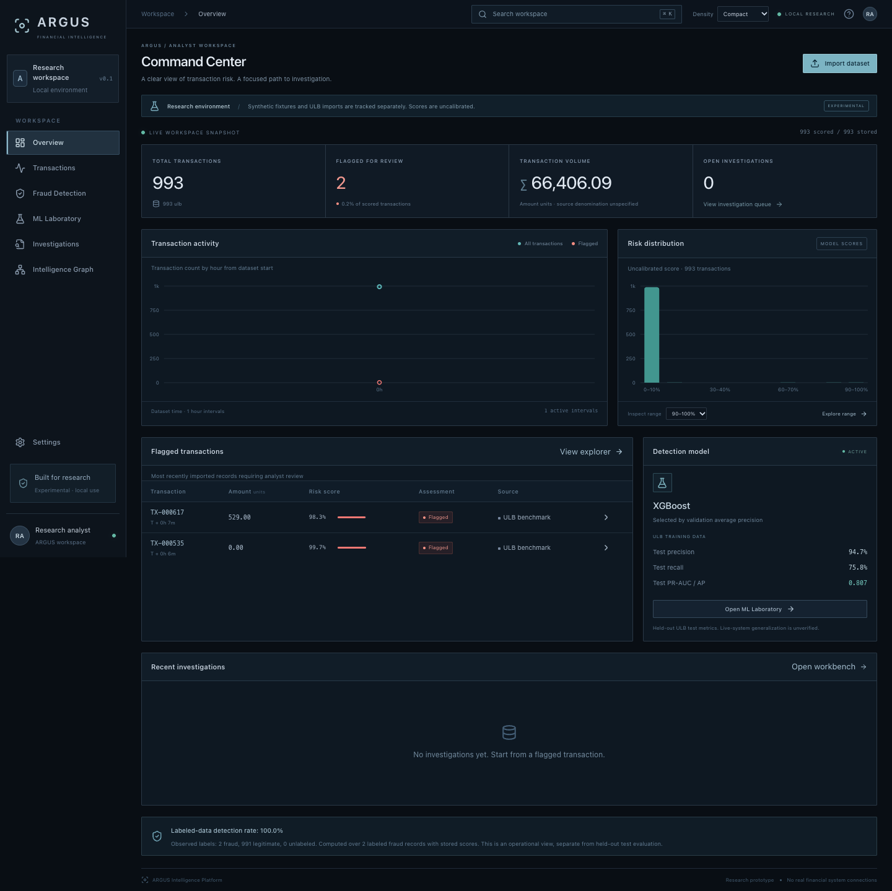</a>

**Mobile** · viewport 390×844; PNG 390×2113 · [dashboard-ulb-mobile.png](dashboard-ulb-mobile.png)

<a href="dashboard-ulb-mobile.png">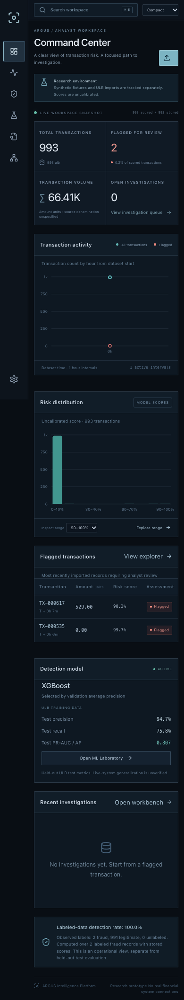</a>

Transaction explorer / search, filters and pagination

Source: ULB.

**Desktop** · viewport 1440×900; PNG 1440×1512 · [transactions-ulb-desktop.png](transactions-ulb-desktop.png)

<a href="transactions-ulb-desktop.png">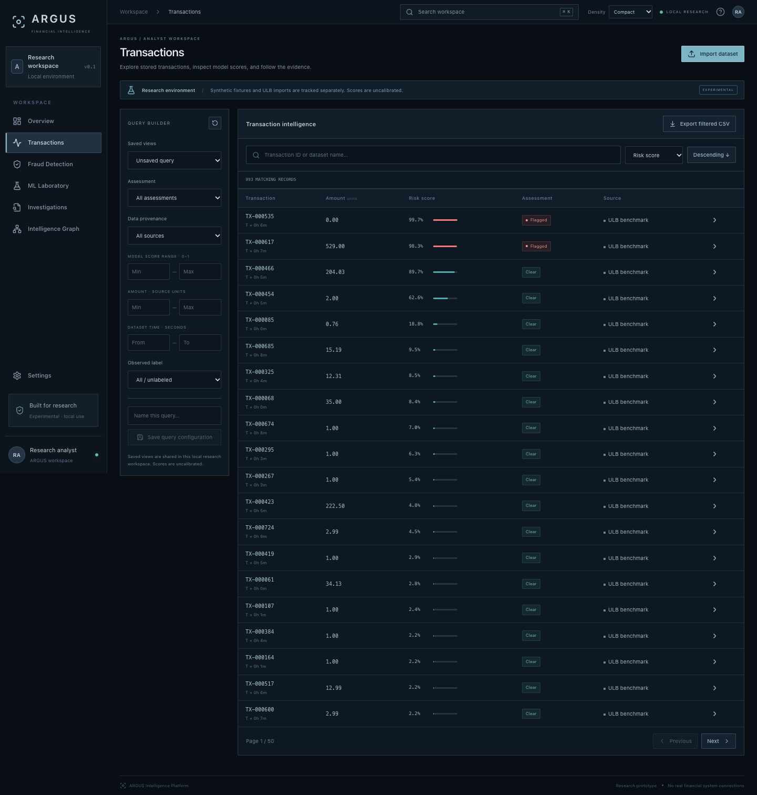</a>

**Mobile** · viewport 390×844; PNG 390×2249 · [transactions-ulb-mobile.png](transactions-ulb-mobile.png)

<a href="transactions-ulb-mobile.png">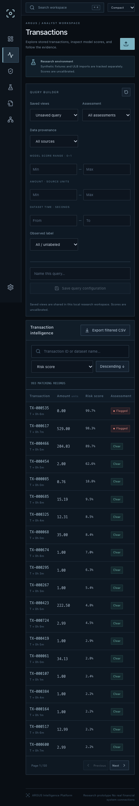</a>

Transaction details / observed label and model output

Source: ULB.

**Desktop** · viewport 1440×900; PNG 1440×1512 · [transaction-details-ulb-desktop.png](transaction-details-ulb-desktop.png)

<a href="transaction-details-ulb-desktop.png">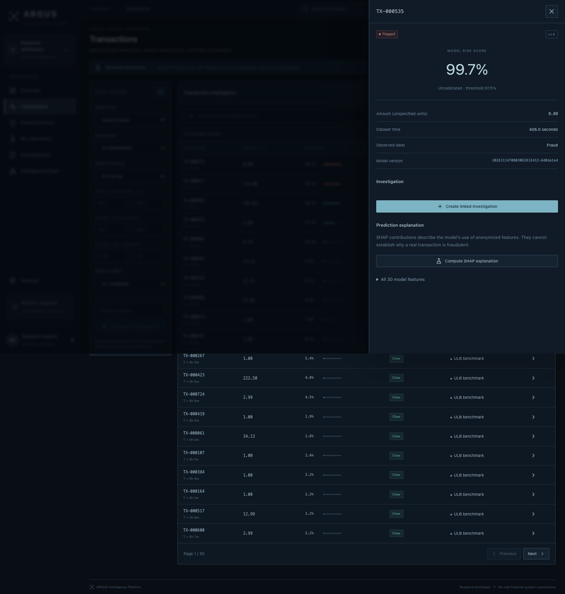</a>

**Mobile** · viewport 390×844; PNG 390×2249 · [transaction-details-ulb-mobile.png](transaction-details-ulb-mobile.png)

<a href="transaction-details-ulb-mobile.png">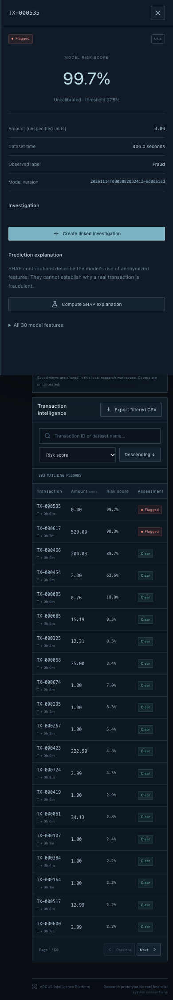</a>

Stored transaction SHAP explanation

Source: ULB; actual active XGBoost contributions.

**Desktop** · viewport 1440×900; PNG 1440×1512 · [transaction-shap-ulb-desktop.png](transaction-shap-ulb-desktop.png)

<a href="transaction-shap-ulb-desktop.png">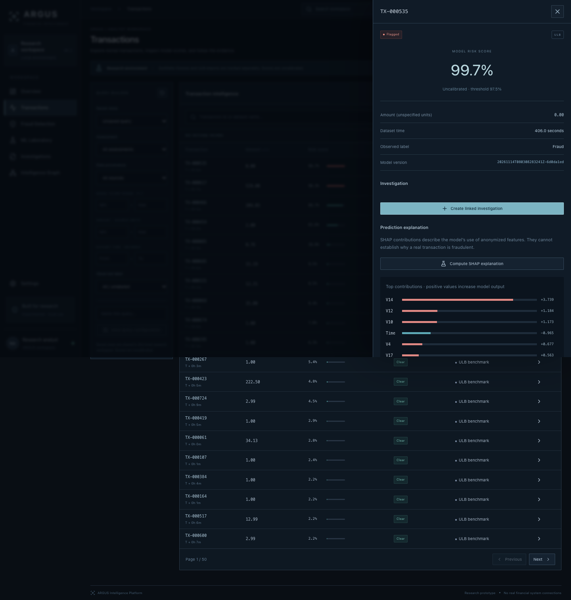</a>

**Mobile** · viewport 390×844; PNG 390×2249 · [transaction-shap-ulb-mobile.png](transaction-shap-ulb-mobile.png)

<a href="transaction-shap-ulb-mobile.png">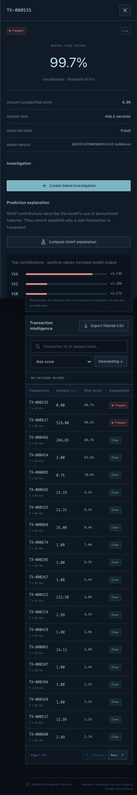</a>

Fraud prediction / actual 30-feature input

Source: Stored ULB example; no fabricated feature values.

**Desktop** · viewport 1440×900; PNG 1440×1634 · [fraud-prediction-form-ulb-desktop.png](fraud-prediction-form-ulb-desktop.png)

<a href="fraud-prediction-form-ulb-desktop.png">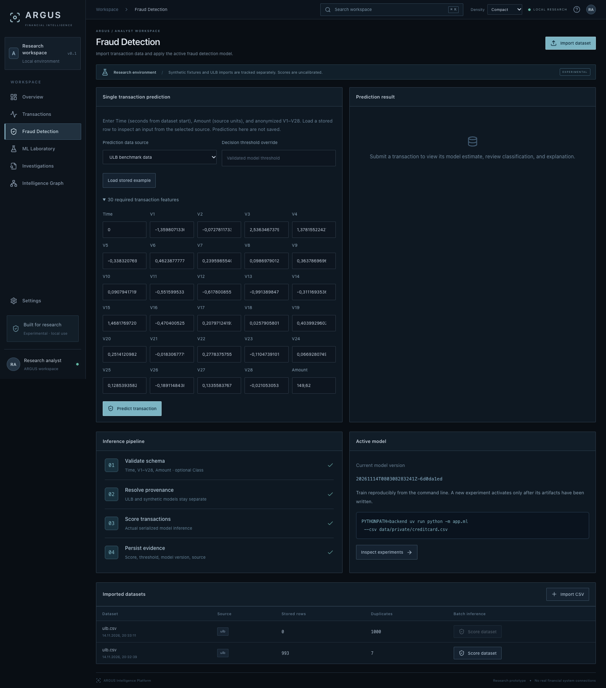</a>

**Mobile** · viewport 390×844; PNG 390×2767 · [fraud-prediction-form-ulb-mobile.png](fraud-prediction-form-ulb-mobile.png)

<a href="fraud-prediction-form-ulb-mobile.png">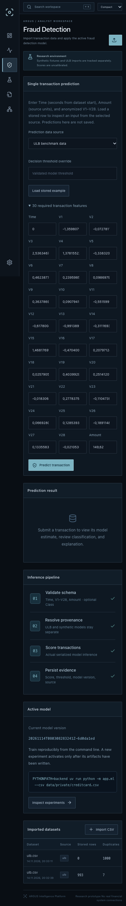</a>

Fraud prediction / probability estimate and risk classification

Source: ULB; actual inference, uncalibrated estimate.

**Desktop** · viewport 1440×900; PNG 1440×1634 · [fraud-prediction-result-ulb-desktop.png](fraud-prediction-result-ulb-desktop.png)

<a href="fraud-prediction-result-ulb-desktop.png">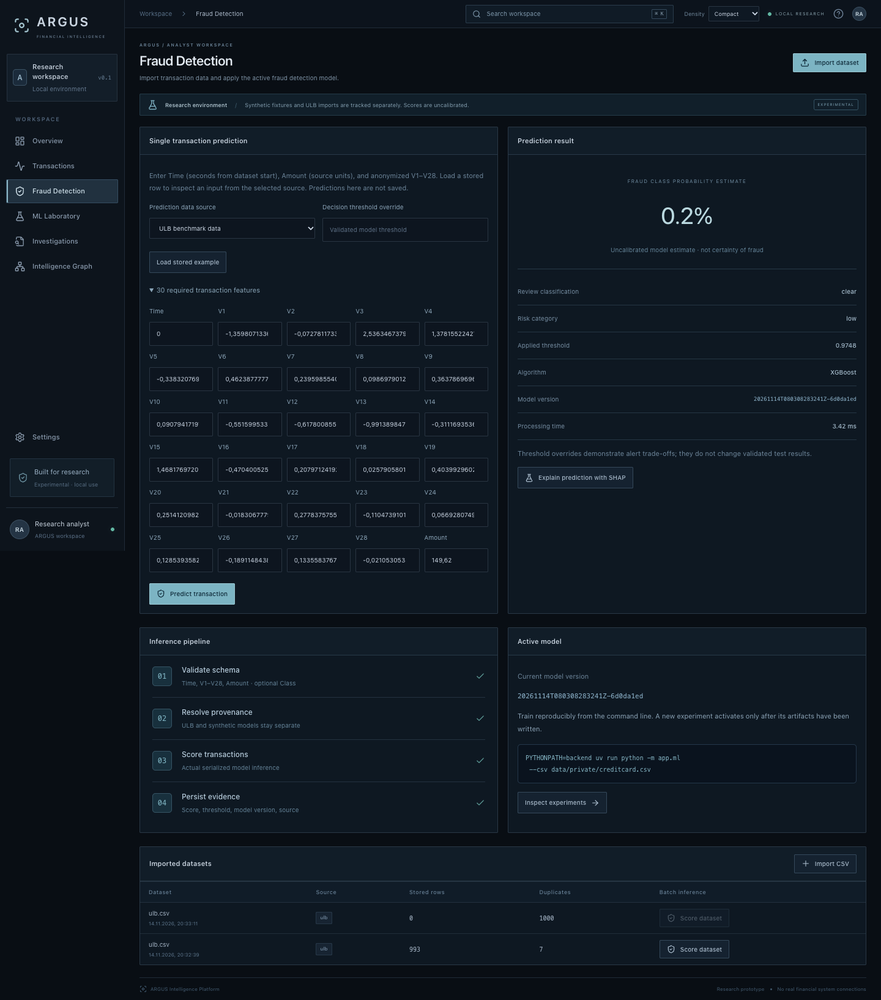</a>

**Mobile** · viewport 390×844; PNG 390×3150 · [fraud-prediction-result-ulb-mobile.png](fraud-prediction-result-ulb-mobile.png)

<a href="fraud-prediction-result-ulb-mobile.png">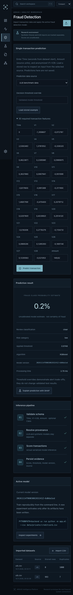</a>

Direct prediction / positive and negative SHAP contributions

Source: ULB; computed on demand.

**Desktop** · viewport 1440×900; PNG 1440×2090 · [fraud-prediction-shap-ulb-desktop.png](fraud-prediction-shap-ulb-desktop.png)

<a href="fraud-prediction-shap-ulb-desktop.png">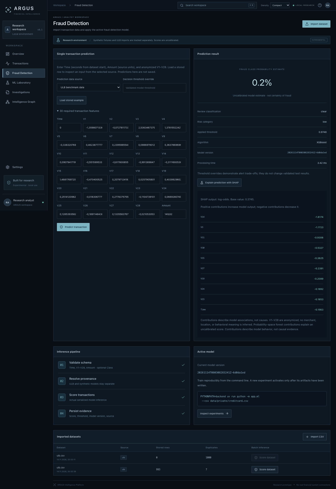</a>

**Mobile** · viewport 390×844; PNG 390×3894 · [fraud-prediction-shap-ulb-mobile.png](fraud-prediction-shap-ulb-mobile.png)

<a href="fraud-prediction-shap-ulb-mobile.png">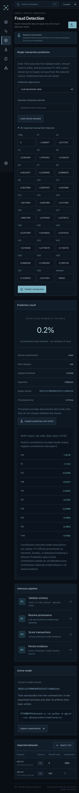</a>

Model performance / comparison, confusion matrix, PR/ROC and calibration

Source: Preserved full ULB stratified experiment; not the 993-row demo evaluation.

**Desktop** · viewport 1440×900; PNG 1440×2194 · [model-performance-ulb-desktop.png](model-performance-ulb-desktop.png)

<a href="model-performance-ulb-desktop.png">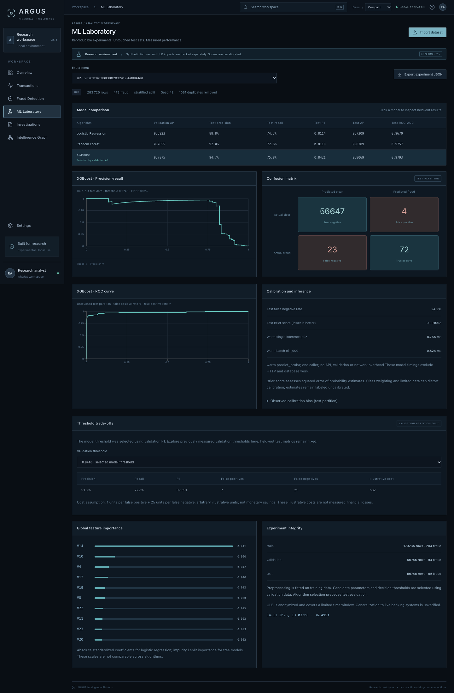</a>

**Mobile** · viewport 390×844; PNG 390×3535 · [model-performance-ulb-mobile.png](model-performance-ulb-mobile.png)

Analytics / validation threshold and illustrative cost trade-offs

Source: Existing validation results; display selection only.

**Desktop** · viewport 1440×900; PNG 1440×2194 · [analytics-thresholds-ulb-desktop.png](analytics-thresholds-ulb-desktop.png)

**Mobile** · viewport 390×844; PNG 390×3535 · [analytics-thresholds-ulb-mobile.png](analytics-thresholds-ulb-mobile.png)

<a href="analytics-thresholds-ulb-mobile.png">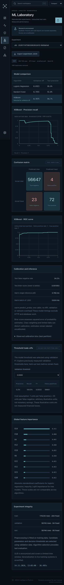</a>

Investigation queue / real-data empty state

Source: Existing ULB workspace has no saved cases; populated saved cases are captured separately.

**Desktop** · viewport 1440×900; PNG 1440×966 · [investigations-ulb-empty-desktop.png](investigations-ulb-empty-desktop.png)

<a href="investigations-ulb-empty-desktop.png">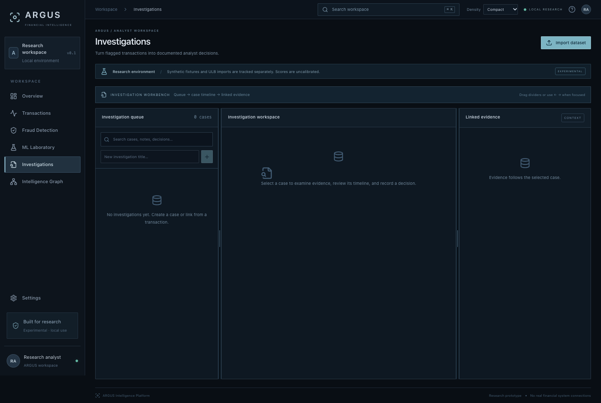</a>

**Mobile** · viewport 390×844; PNG 390×1218 · [investigations-ulb-empty-mobile.png](investigations-ulb-empty-mobile.png)

System information / model, dataset, health and schema

Source: Actual runtime metadata; access-key input is empty.

**Desktop** · viewport 1440×900; PNG 1440×1153 · [system-information-ulb-desktop.png](system-information-ulb-desktop.png)

**Mobile** · viewport 390×844; PNG 390×1687 · [system-information-ulb-mobile.png](system-information-ulb-mobile.png)

Dataset import / schema and provenance controls

Source: Existing import UI; no file selected or uploaded.

**Desktop** · viewport 1440×900; PNG 1440×1439 · [dataset-import-dialog-desktop.png](dataset-import-dialog-desktop.png)

**Mobile** · viewport 390×844; PNG 390×2113 · [dataset-import-dialog-mobile.png](dataset-import-dialog-mobile.png)

Workspace search / keyboard navigation

Source: Existing command menu; no writes.

**Desktop** · viewport 1440×900; PNG 1440×1439 · [workspace-search-desktop.png](workspace-search-desktop.png)

**Mobile** · viewport 390×844; PNG 390×2113 · [workspace-search-mobile.png](workspace-search-mobile.png)

Investigation workbench / existing saved case, evidence and timeline

Source: Existing persisted synthetic demonstration case; no new notes/cases created.

**Desktop** · viewport 1440×900; PNG 1440×1142 · [investigation-workbench-synthetic-desktop.png](investigation-workbench-synthetic-desktop.png)

**Mobile** · viewport 390×844; PNG 390×2337 · [investigation-workbench-synthetic-mobile.png](investigation-workbench-synthetic-mobile.png)

Intelligence graph / entity inspection and relationships

Source: Existing separate synthetic relational fixture; no ULB identities or inferred relationships.

**Desktop** · viewport 1440×900; PNG 1440×1174 · [intelligence-graph-synthetic-desktop.png](intelligence-graph-synthetic-desktop.png)

**Mobile** · viewport 390×844; PNG 390×1911 · [intelligence-graph-synthetic-mobile.png](intelligence-graph-synthetic-mobile.png)

## Earlier screenshots retained

These pre-existing captures are preserved unchanged for documentation continuity. Their data/model/state may differ from the latest views; use the displayed provenance labels and the latest captures above for current visual review.

graph-upgrade.png — 1440×1174

[graph-upgrade.png](graph-upgrade.png)

investigation-mobile.png — 390×3272

[investigation-mobile.png](investigation-mobile.png)

investigation-upgrade.png — 1440×1112

[investigation-upgrade.png](investigation-upgrade.png)

laboratory.png — 1440×1443

[laboratory.png](laboratory.png)

overview-mobile.png — 390×2235

[overview-mobile.png](overview-mobile.png)

overview-synthetic.png — 1440×1379

[overview-synthetic.png](overview-synthetic.png)

overview.png — 1440×1354

[overview.png](overview.png)

transactions-upgrade.png — 1440×1520

[transactions-upgrade.png](transactions-upgrade.png)

ulb-explanation.png — 1440×1520

[ulb-explanation.png](ulb-explanation.png)

